# Allelescope User Manual

*Covers Allelescope 0.1.02 as on the `main` branch of `22noon/consensus` (pull requests #1 to #8). Revised 18 November 2026. Also available as a [web page](https://22noon.github.io/consensus/) and a [PDF](docs/allelescope-user-manual.pdf).*

Allelescope is a web-based viewer for checking variant calls against the reads behind them. You pick a site, and Allelescope shows the reads that cross it, together with their mates and split-read partners, in an embedded IGV view. You can narrow those reads down by flag, pairing, strand, edit distance, soft clipping or observed allele, pick out individual reads to keep, hide or download, and record a verdict for each variant as you go.

This manual has two audiences:

- **People who review variants** in a browser that somebody else has set up: start at [Opening a browser instance](#4-opening-a-browser-instance).
- **People who set Allelescope up**: start at [Installing](#2-installing).

All screenshots were taken from a running copy of this version, using small synthetic datasets described in [Appendix B](#appendix-b-the-datasets-used-in-the-figures). Section 14 lists the few places where this version still behaves differently from what the screen suggests.

## Contents

1. [How Allelescope works](#1-how-allelescope-works)
2. [Installing](#2-installing)
3. [Building a browser instance](#3-building-a-browser-instance)
4. [Opening a browser instance](#4-opening-a-browser-instance)
5. [A tour of the screen](#5-a-tour-of-the-screen)
6. [Looking at a variant](#6-looking-at-a-variant)
7. [Reviewing a list of variants](#7-reviewing-a-list-of-variants)
8. [Genomes with many sequences](#8-genomes-with-many-sequences)
9. [Alleles at a site](#9-alleles-at-a-site)
10. [Very deep sites](#10-very-deep-sites)
11. [Filtering reads](#11-filtering-reads)
12. [Selecting, isolating and exporting reads](#12-selecting-isolating-and-exporting-reads)
13. [Housekeeping: caches, saved lists and presets](#13-housekeeping-caches-saved-lists-and-presets)
14. [Known issues in this version](#14-known-issues-in-this-version)
15. [Worked examples](#15-worked-examples)
16. [Troubleshooting](#16-troubleshooting)

Appendices: [A. Reference tables](#appendix-a-reference-tables) · [B. The datasets used in the figures](#appendix-b-the-datasets-used-in-the-figures)

---

## 1. How Allelescope works

Allelescope has three parts: a build command that prepares one sample, a small web server, and the viewer page that runs in your web browser.

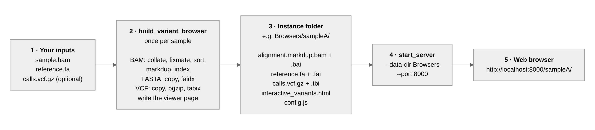

*Figure 1. From input files to a browser instance.*

A **browser instance** is one folder holding the prepared files for one sample. A **data directory** is a folder that holds one or more instances. One server serves a whole data directory, and each instance gets its own web address.

When you choose a site, the page does not load the whole BAM. It asks the server for the reads at that one site:

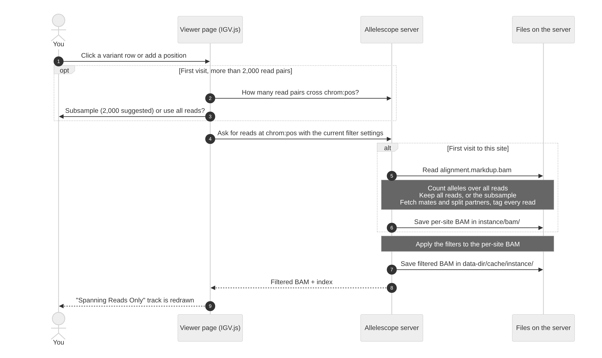

*Figure 2. What happens when you click a variant or add a position. The question about subsampling is asked only at very deep sites ([section 10](#10-very-deep-sites)).*

Two consequences are worth knowing:

- **The first visit to a site is slower than later visits.** The server extracts and tags the reads once and keeps the result. While it works, the allele panel says *Preparing reads at …*.
- **Filtering happens on the server.** Each change of filter fetches a new, smaller read set, which is why Allelescope can filter on things a plain IGV session cannot, such as "the mate of a read that crosses this site".

The read track is named **Spanning Reads Only**, but it holds more than the reads that cross the site. Allelescope also fetches the mate of every crossing read and the other parts of split reads, wherever they map:

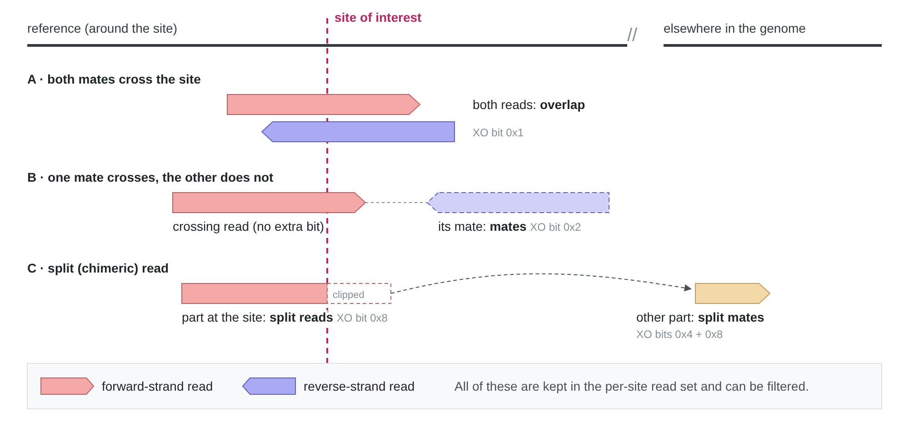

*Figure 3. The kinds of read stored for a site, with the names used in the filter panel.*

---

## 2. Installing

### 2.1 With pip

Allelescope needs Python 3.12 or later.

```bash
pip install allelescope
```

This installs three commands: `build_variant_browser`, `start_server` and `generate_viewer` (the last is called for you by the build step).

The build step also needs these command-line tools on your `PATH`:

| Tool | Needed | Used for |
|---|---|---|
| `samtools` | always | collate, fixmate, sort, markdup, index, faidx |
| `bgzip` | only with a VCF | compressing a plain-text VCF |
| `tabix` | only with a VCF | indexing the VCF |

The project was developed with samtools 1.19.2 and htslib 1.19, and this manual was tested with samtools 1.19.2. One way to get them:

```bash
conda create -n allelescope -c conda-forge -c bioconda samtools=1.19.2 htslib=1.19
conda activate allelescope
pip install allelescope
```

### 2.2 With Docker (Windows, macOS, Linux)

pysam and samtools do not run on Windows, so on Windows use the Docker image, which also works on macOS and Linux. From the repository folder:

```bash
docker build -t allelescope .
docker run --rm -p 127.0.0.1:8000:8000 allelescope demo
```

The second command builds the demo instance and serves it at `http://localhost:8000/demo/`. To build and serve your own data, mount a folder at `/data` and use the `build` and `serve` commands; `docker/README.md` in the repository gives the exact commands for PowerShell, Command Prompt and macOS/Linux. Instance folders built with Docker can be served by a normal installation and the other way round.

### 2.3 Internet access

**The computer that displays the viewer needs internet access.** The page loads IGV.js, Bootstrap and its icons from `cdn.jsdelivr.net`. If that site is blocked, the page opens without its layout and without the alignment view.

---

## 3. Building a browser instance

### 3.1 What you need

| Input | Required | Notes |
|---|---|---|
| BAM file | yes | Aligned reads. Keep the `MD` tags that aligners such as `bwa mem` write (see the note below). |
| Reference FASTA | yes | The reference the reads were aligned to. It can have any number of sequences: chromosomes, the segments of a segmented virus, or the contigs of an assembly. |
| VCF or VCF.gz | no | Must be sorted. Without it, the viewer starts with an empty variant list and you add positions by hand. |

> **Note on `MD` tags.** Allelescope uses the `MD` tag to tell a reference base from a mismatch. If your BAM has no `MD` tags, SNP alleles in the allele panel are labelled `REF` instead of `SNP` (the base shown is still correct). Add the tags first with `samtools calmd -b in.bam reference.fa > out.bam`.

### 3.2 Preparing the VCF (recommended)

Normalising the VCF splits multi-allelic records and left-aligns indels, so that each row in the viewer is one allele:

```bash
bcftools norm -f reference.fa -m -any raw_calls.vcf.gz \
  | bcftools +fill-tags -- -t all \
  | bcftools view -o calls.norm.vcf.gz -O z

bcftools index -t calls.norm.vcf.gz
```

From the VCF the viewer shows, next to each variant:

- the `DP` value from the `INFO` column, as a note;
- the allele fraction (**AF** column), taken from `INFO/AF`, or else from the first sample's `AF` or `VAF`, or else worked out from its `AD`. When the VCF has none of these, the fraction observed in the reads is shown once you open the site.

### 3.3 Running the build

```bash
build_variant_browser -b sample.bam -r reference.fa -v calls.norm.vcf.gz -o Browsers/sampleA
```

| Option | Default | Meaning |
|---|---|---|
| `-b`, `--bam` | required | Input BAM |
| `-r`, `--reference` | required | Reference FASTA |
| `-v`, `--variants` | none | VCF or VCF.gz, sorted |
| `-o`, `--out-dir` | `./out_dir` | Instance folder to create |
| `-g`, `--genome-name` | first contig in the VCF, otherwise first sequence in the BAM header | Name shown for the reference |
| `-t`, `--threads` | `10` | Threads for samtools |

The command prints each stage as it runs and stops at the first error. It:

1. checks that the input files and tools exist;
2. works out the genome name;
3. runs the BAM through `samtools collate → fixmate → sort → markdup` and indexes the result, so that mate information is consistent and duplicates are flagged;
4. copies the reference and indexes it;
5. copies the VCF, compresses it if needed, and indexes it;
6. writes the viewer page.

The instance folder then contains:

```
Browsers/sampleA/
├── alignment.markdup.bam        duplicate-marked alignments
├── alignment.markdup.bam.bai
├── reference.fa                 copy of your reference (keeps its own file name)
├── reference.fa.fai
├── calls.norm.vcf.gz            copy of your VCF (only if -v was given)
├── calls.norm.vcf.gz.tbi
├── config.js                    settings for the viewer page
└── interactive_variants.html    the viewer page
```

Later, the server adds a `bam/` folder here for the per-site read sets.

To serve several samples together, build each one into its own folder under the same data directory:

```bash
build_variant_browser -b A.bam -r ref.fa -v A.vcf.gz -o Browsers/sampleA
build_variant_browser -b B.bam -r ref.fa -v B.vcf.gz -o Browsers/sampleB
```

> **Rebuilding an instance.** If you rebuild into a folder that has been used before, delete its `bam/` folder and clear the cache (section 13.1) first. Otherwise sites you visited earlier are still served from the old reads.

> **Instances built with an earlier version** keep working: the viewer loads its newer parts by itself. Rebuild (or run `generate_viewer` again) only if you want the page itself refreshed.

---

## 4. Opening a browser instance

### 4.1 Start the server

```bash
start_server --data-dir Browsers --port 8000
```

| Option | Default | Meaning |
|---|---|---|
| `--data-dir`, `-d` | current folder | Folder that holds the instance folders |
| `--port` | `8000` | Port to listen on |
| `--host` | `0.0.0.0` | Network address to listen on |
| `--debug` | off | Flask debug mode |

Leave the server running while you work. You can add new instance folders without restarting it. The server creates a `cache/` folder inside the data directory.

> **Access.** The server has no login, and by default it listens on every network interface. Anyone who can reach the port can read the data and clear the caches. On a shared machine, start it with `--host 127.0.0.1` and reach it through an SSH tunnel.

### 4.2 Open the page

Use the instance folder name followed by a slash:

```
http://localhost:8000/sampleA/
```

The address of the page file itself, `http://localhost:8000/sampleA/interactive_variants.html`, works too. An address can also point at one variant and a set of filters, for example `http://localhost:8000/sampleA/#v=chr1:2450`; see [section 7.6](#76-sharing-a-view).

Chrome, Edge and Firefox are the browsers the project names as supported.

### 4.3 If the server is on another machine

Forward the port over SSH from your own computer, then open the address locally:

```bash
ssh -L 8000:localhost:8000 user@remote.host
```

```
http://localhost:8000/sampleA/
```

If port 8000 is taken on your computer, change the first number (`-L 9000:localhost:8000`) and open `http://localhost:9000/sampleA/`.

### 4.4 What you see first

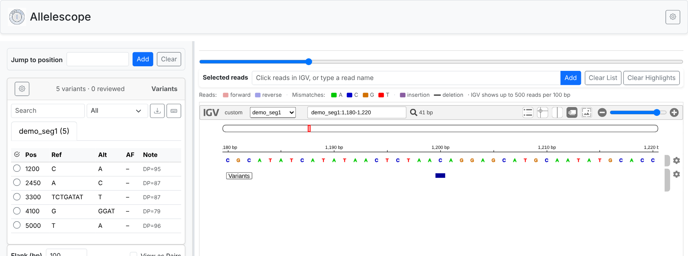

*Figure 4. The page straight after loading. The variant list is filled in, but there is no read track until you choose a site.*

---

## 5. A tour of the screen

The left pane is where you choose sites, record your review and set filters. The right pane is the IGV alignment view.

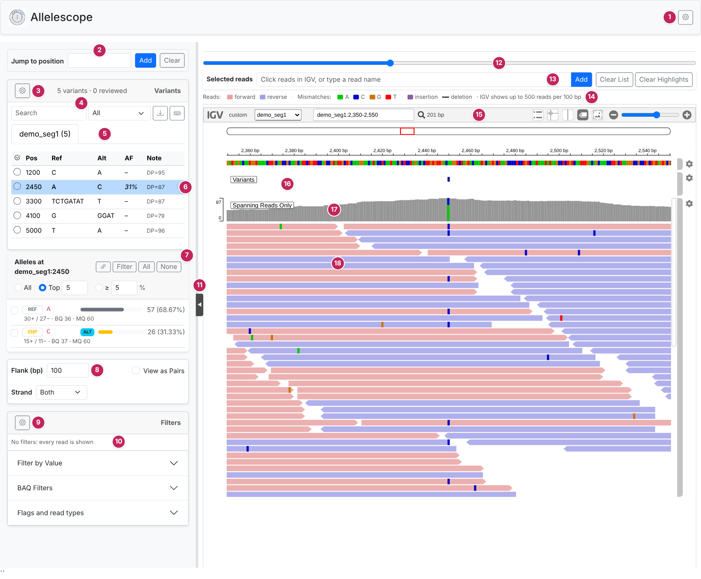

*Figure 5. The main window with a variant selected.*

| # | Part | What it is for |
|---|---|---|
| 1 | Header gear | Cached reads and what your browser has saved ([section 13](#13-housekeeping-caches-saved-lists-and-presets)) |
| 2 | **Jump to position** | Add positions that are not in the VCF ([section 9.5](#95-add-a-position-that-is-not-in-the-vcf)) |
| 3 | Variants gear | How the list of sequences is shown, empty sequences, saved variant lists |
| 4 | Variant toolbar | Search, status filter, review download, keyboard shortcuts ([section 7](#7-reviewing-a-list-of-variants)) |
| 5 | Sequence tabs | One tab per reference sequence, with its number of variants ([section 8](#8-genomes-with-many-sequences)) |
| 6 | Variant table | Status, position, alleles, AF and your note. Click a row to view that site |
| 7 | **Alleles at …** panel | The alleles at the selected site, with strand and quality, and the allele filter ([section 9](#9-alleles-at-a-site)) |
| 8 | View options | **Flank**, **View as Pairs**, **Strand** |
| 9 | **Filters** | Gear for reset, download and presets ([section 11](#11-filtering-reads)) |
| 10 | Filters in use | The filters currently switched on; the Filters header shows how many |
| 11 | Pane handle | Drag the divider to resize the left pane; click the arrow to hide or show it |
| 12 | Height slider | Height of the read track |
| 13 | **Selected reads** | Reads you have picked, and what to do with them ([section 12](#12-selecting-isolating-and-exporting-reads)) |
| 14 | Colour key | What the read colours mean |
| 15 | IGV toolbar | Sequence selector, position box, zoom |
| 16 | **Variants** track | The VCF records. Clicking one selects its row in the table |
| 17 | Coverage | Depth of the reads currently shown, with allele colours at mismatching positions |
| 18 | Reads | Coloured by strand: pink reads are on the forward strand, blue-violet reads on the reverse strand |

Inside the read track, IGV's usual conventions apply, as the colour key above the view says. A coloured tick on a read is a base that differs from the reference (green A, blue C, orange G, red T). A black line through a read is a deletion, and a small purple mark is an insertion. Drag to pan, and use the **+** and **−** buttons or the zoom slider to zoom. IGV draws at most 500 reads per 100 bases; its coverage bar counts all of them.

Pointing at most controls shows a short explanation.

To give the alignment view more room, drag the divider or click the arrow on it:

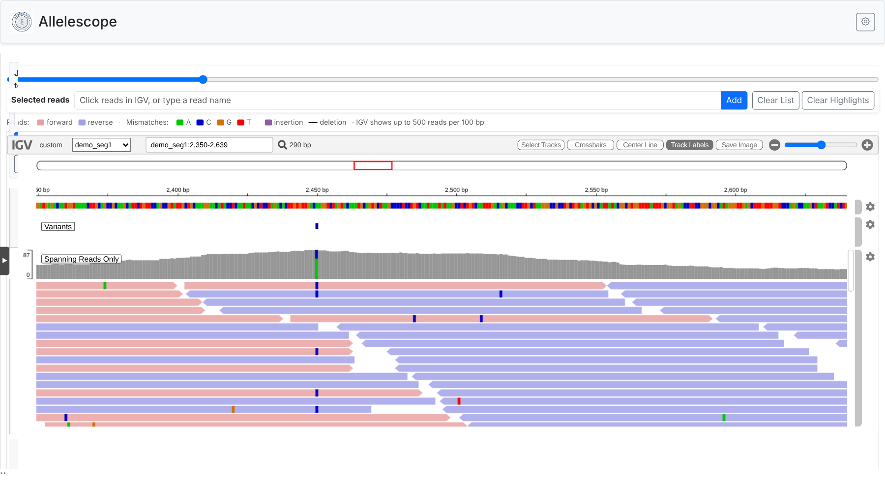

*Figure 6. Left pane hidden. Click the arrow at the left edge to bring it back. The page remembers this choice.*

---

## 6. Looking at a variant

### 6.1 Choose a variant

1. Click the tab for the reference sequence. The number in brackets is how many variants it has.
2. Click a row in the table. The row turns blue, the alignment view moves to that site and loads its reads, and an **Alleles at …** panel for the site appears below the list ([section 9](#9-alleles-at-a-site)).

The first click on a site takes a moment while the server prepares its reads.

You can also click a variant in the **Variants** track of the alignment view. It selects the matching row, exactly as if you had clicked it in the table. Clicking the variant that is already selected opens IGV's details box for the VCF record instead.

With the keyboard, **J** and **K** (or the down and up arrows) move to the next and previous variant ([section 7.3](#73-the-keyboard)).

Sequences with no variants are hidden by default. To see them, open the Variants gear and switch on **Show empty chromosomes**:

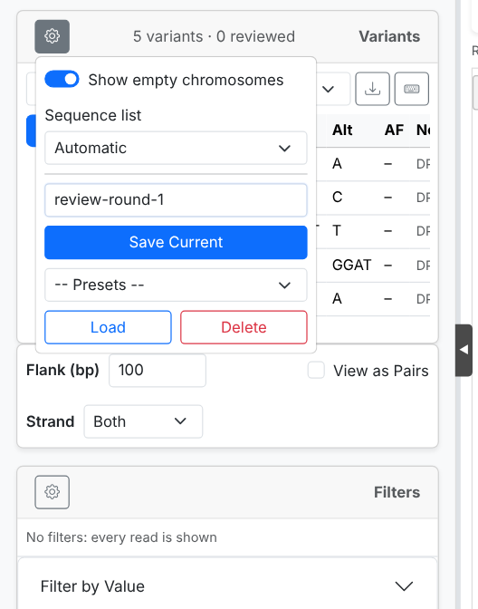

*Figure 7. The Variants gear menu. Sequence list is explained in [section 8](#8-genomes-with-many-sequences); the lower part saves and loads variant lists ([section 13.3](#133-variant-list-presets)).*

### 6.2 Set how much sequence is shown

**Flank (bp)** sets how many bases are shown on each side of the site. The default is 100, and the intended range is 10 to 1000. A new value takes effect the next time you click a row, so click the current row again to apply it.

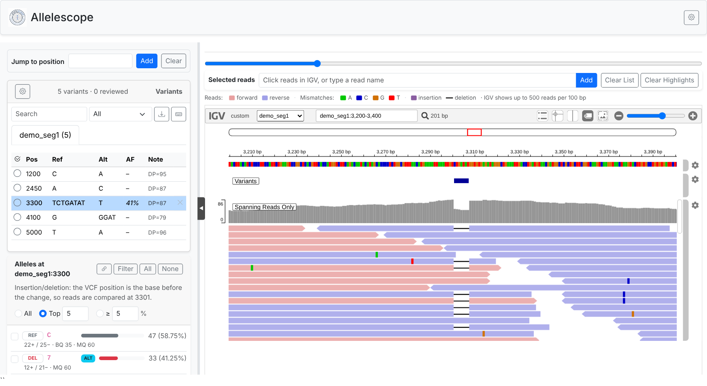

*Figure 8. A 7-base deletion with the default flank of 100 bp. Reads carrying the deletion have a black line through the deleted bases, and the coverage dips. The allele panel below the list gives the split between reference and deletion.*

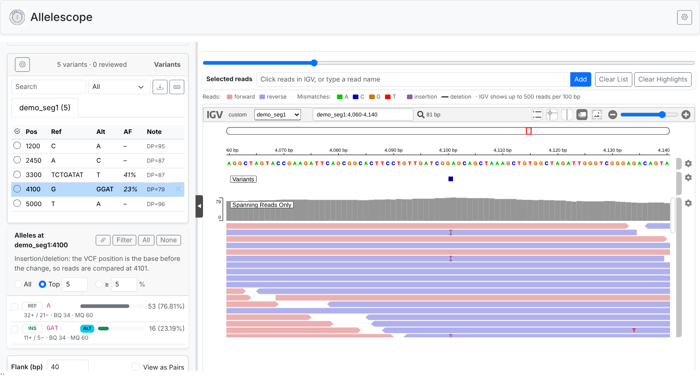

*Figure 9. An insertion with the flank set to 40 bp. At this zoom the reference bases are readable, and reads carrying the insertion have a purple mark.*

### 6.3 Look at pairs

Tick **View as Pairs** to draw each read together with its mate, joined by a line.

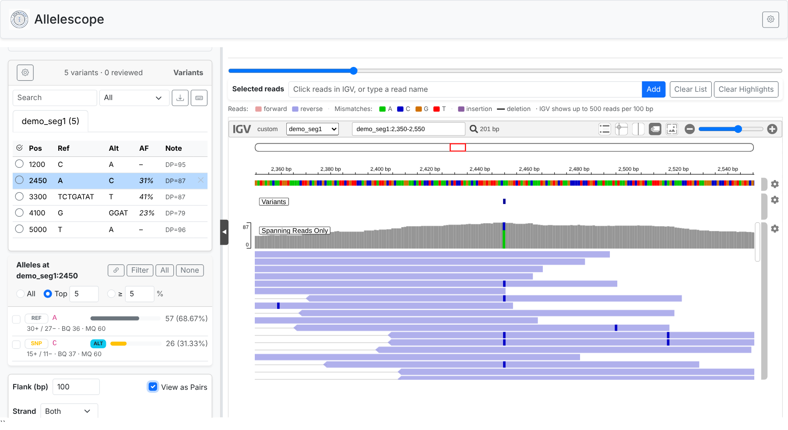

*Figure 10. View as Pairs. The setting also appears in the list of filters in use.*

### 6.4 Read the details of one read

Click a read to open IGV's details box. Besides the standard fields, it lists the tags Allelescope adds, which are what the filters work on:

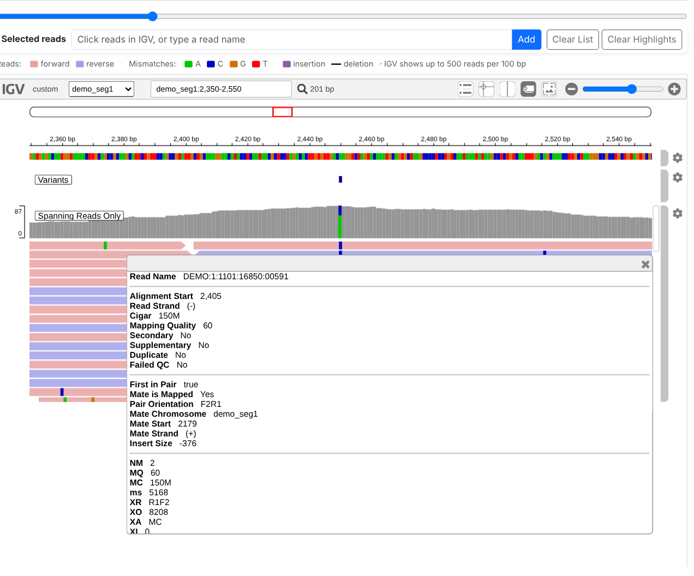

*Figure 11. Details of a read. Here `XR` (pair orientation) is `R1F2`, `XO` is 8208 and `XA` (the allele this read shows at the site) is `MC`, a mismatch to C. Scroll inside the box for the remaining tags.*

The tags are explained in [Appendix A](#appendix-a-reference-tables).

### 6.5 The variant table

| Column | Shows |
|---|---|
| Status icon | Your review status: an empty circle (not reviewed), Confirmed, Doubtful or Artefact ([section 7](#7-reviewing-a-list-of-variants)) |
| **Pos**, **Ref**, **Alt** | The VCF record. Long alleles are shortened; point at one to see it in full |
| **AF** | The allele fraction from the VCF. If the VCF has none, the fraction seen in the reads appears *in italics* once you have opened the site |
| **Note** | Your note, or the VCF `INFO` summary (for example `DP=87`) until you write one. Point at the cell to see the VCF `INFO` |
| × | Removes the row. It appears when you point at the row |

- Click **Pos**, **AF** or the status icon in the header to sort the table; click again to reverse the order.
- Removing a row asks no question; a message in the bottom-right corner offers **Undo**. Your browser remembers the removal ([section 13.2](#132-what-your-browser-remembers)).

---

## 7. Reviewing a list of variants

### 7.1 Statuses and notes

Every variant can carry a **status**, **Confirmed**, **Doubtful** or **Artefact**, and a **note**. Click the circle at the start of a row to choose a status:

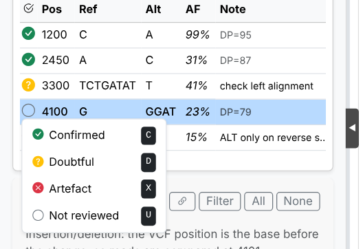

*Figure 12. The status menu. The letters on the right are the keyboard shortcuts.*

To write a note, double-click the **Note** cell of a row (or press **E** for the selected row), type, and press Enter. Esc cancels. A note replaces the VCF `INFO` summary in the cell; the summary is still shown when you point at the cell.

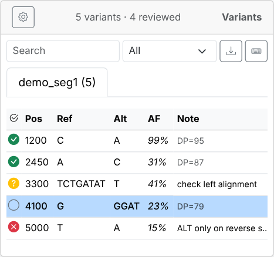

*Figure 13. A partly reviewed list: two variants confirmed, one doubtful with a note, one artefact with a note, and one not yet reviewed. The header counts the variants with a status.*

Statuses and notes are kept in your web browser, separately for each instance, and survive reloading the page. They are not shared with other people or other browsers; to pass them on, download the review ([section 7.5](#75-download-the-review)).

### 7.2 Find and filter variants

The toolbar above the sequence tabs helps with long lists:

- **Search** finds positions, alleles and notes (press **/** to jump to it).
- The list next to it shows only variants with one status, for example **Not reviewed**:

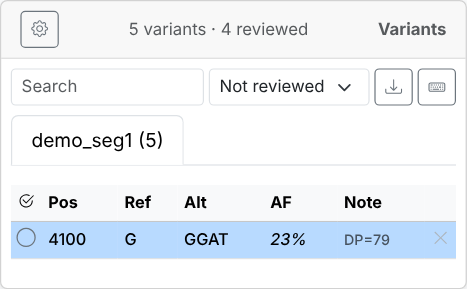

*Figure 14. The status filter set to Not reviewed.*

### 7.3 The keyboard

Going through a list is fastest with the keyboard. Press **?** (or the keyboard button in the toolbar) for this list:

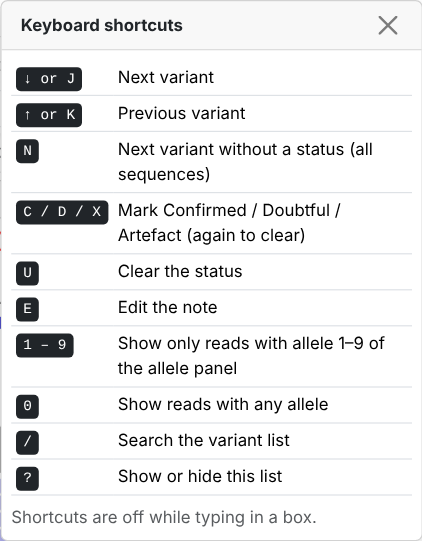

*Figure 15. The keyboard shortcuts.*

| Key | Does |
|---|---|
| ↓ or **J**, ↑ or **K** | Next / previous variant on the current sequence |
| **N** | Next variant without a status, moving on to the next sequence when needed |
| **C**, **D**, **X** | Mark Confirmed, Doubtful, Artefact; press again to clear |
| **U** | Clear the status |
| **E** | Edit the note |
| **1** – **9** | Show only the reads with that allele of the allele panel ([section 9.4](#94-filter-by-allele)) |
| **0** | Show reads with any allele |
| **/** | Search the variant list |
| **?** | Show or hide the list of shortcuts |

Shortcuts are off while you type in a box.

### 7.4 A review routine

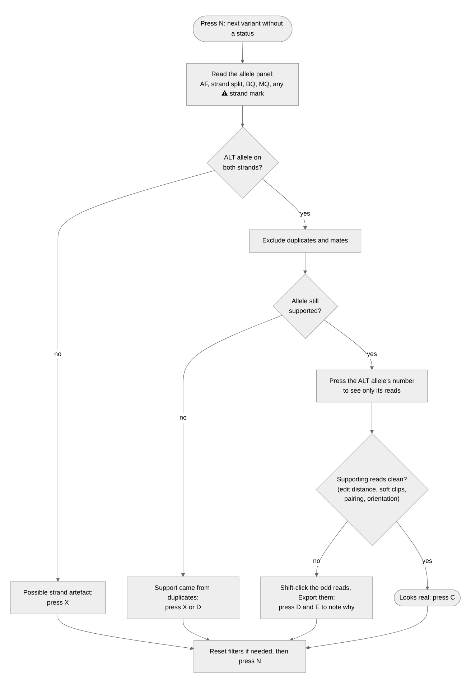

*Figure 16. A review routine with the keyboard. Adapt the checks to your own data and thresholds.*

### 7.5 Download the review

The download button in the toolbar offers two files:

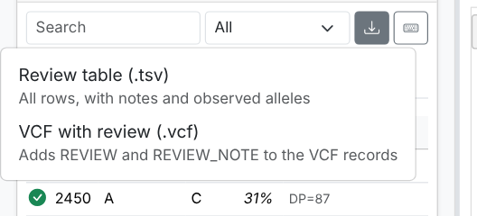

*Figure 17. Downloading the review.*

- **Review table (.tsv)**: one line per variant with sequence, position, REF, ALT, VCF `INFO`, AF (and whether it came from the VCF or the reads), status, note and, for the sites opened in this session, the alleles seen with their counts and strand split. It opens in any spreadsheet program.
- **VCF with review (.vcf)**: the instance's VCF with two `INFO` fields added to the reviewed records: `REVIEW` (`confirmed`, `doubtful` or `artefact`) and `REVIEW_NOTE`. Characters a VCF cannot hold in a note are percent-encoded: `%20` for a space, `%3B` for `;`, `%2C` for `,`. Positions you added by hand are not in the VCF; they are in the .tsv.

### 7.6 Sharing a view

The address in the browser's address bar records what you are looking at: the variant, the filters, the allele filter and the subsample size. For example

```
http://localhost:8000/demo/#v=demo_seg1:5000&on=retain-duplicates&xa=MA
```

shows `demo_seg1:5000` with duplicates excluded and only the reads carrying an A. Send the address to a colleague on the same server, or use the link button in the allele panel to copy it, and they see the same view. A position that is not in their variant list is added to it.

The browser's **Back** and **Forward** buttons move between the variants you have opened.

---

## 8. Genomes with many sequences

Segmented viruses (influenza has eight segments), multi-chromosome genomes and assemblies with many contigs give the variant list one tab per sequence. With more than a few, the tabs do not fit across the pane:

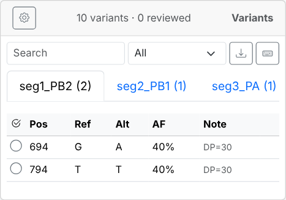

*Figure 18. Eight influenza-like segments as tabs across the top: only three are visible, and the rest are off to the right.*

### 8.1 Tabs down the side

When the tabs do not fit in one row, Allelescope puts them in a column beside the variant table. Each tab shows the sequence name and its number of variants:

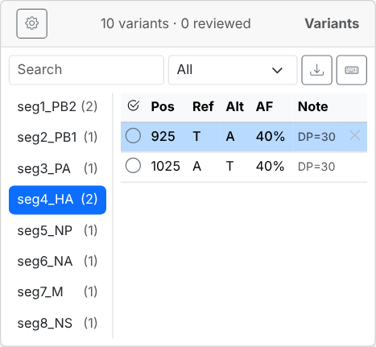

*Figure 19. The same eight segments as tabs down the side, with segment 4 selected.*

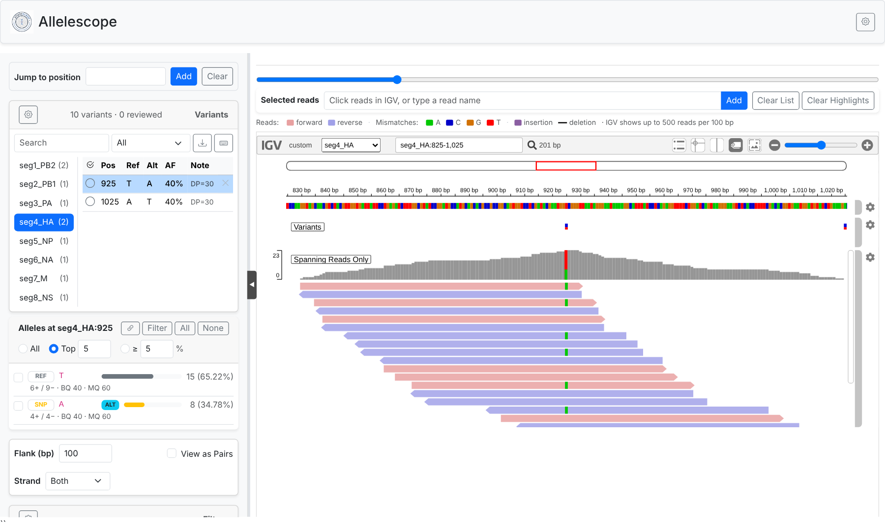

*Figure 20. The whole window with a variant on segment 4 selected.*

Long names are shortened; point at a tab to see the full name. The column scrolls when there are more sequences than fit.

### 8.2 Many contigs

From nine sequences on, a **Find sequence** box appears above the column. Type part of a name to list only the sequences that match:

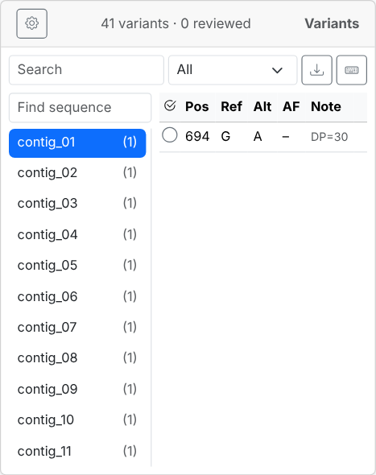

*Figure 21. An assembly with 41 contigs.*

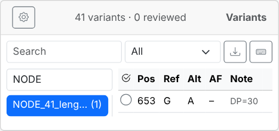

*Figure 22. Typing `NODE` finds the one contig with a long assembler name, shortened in the tab.*

### 8.3 A drop-down list

If you would rather keep the full width for the table, choose a drop-down list instead:

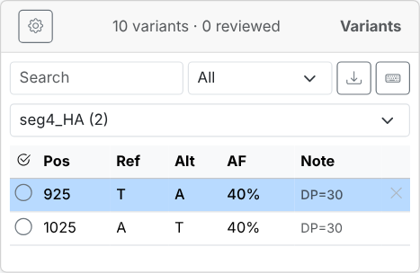

*Figure 23. The sequence list as a drop-down.*

### 8.4 Choosing the layout

The layout is set under **Sequence list** in the Variants gear:

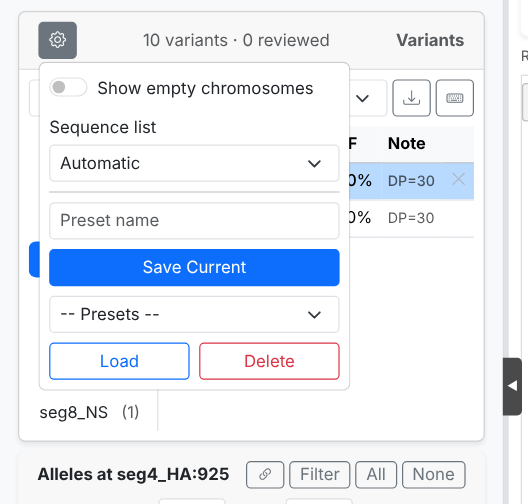

*Figure 24. The Sequence list setting in the Variants gear.*

| Setting | Behaviour |
|---|---|
| **Automatic** (default) | Tabs across the top while they all fit in one row, otherwise tabs down the side. Checked again when you resize the pane. |
| **Tabs across the top** | One row, scrolling sideways when needed |
| **Tabs down the side** | A column beside the table, with **Find sequence** from nine sequences |
| **Drop-down list** | A single list above the table |

Your browser remembers the choice. **Show empty chromosomes** works with every layout.

Other things that help with many sequences:

- **N** goes to the next variant without a status across all sequences, switching tabs for you ([section 7.3](#73-the-keyboard)).
- **Search** in the variant toolbar filters the tables of every sequence; switch tabs to see the matches on other sequences.
- Clicking a tab only switches the table; the alignment view moves when you click a variant.

---

## 9. Alleles at a site

### 9.1 The allele panel

Whenever you select a variant or add a position, the **Alleles at …** panel below the variant list shows every allele the reads carry at that site (item 7 in Figure 5).

| Part | Meaning |
|---|---|
| Tick box | Choose the allele for filtering |
| Type | `REF` reference base, `SNP` mismatch, `DEL` deletion, `INS` insertion, `?` anything else |
| Allele | The base for REF and SNP, the length for DEL, the inserted bases for INS |
| `ALT` badge | Marks the allele that matches the ALT of the VCF record. Positions added by hand have no VCF record, so no badge |
| Bar and numbers | Number of read pairs showing the allele, and their share |
| Second line | Reads on the forward and reverse strand, mean base quality at the site (`BQ`) and mean mapping quality (`MQ`) |

Counts are per read pair, not per read: when both mates cross the position, the pair is counted once, using the read that crosses the site.

The row above the list controls which alleles are listed: **All**, the **Top** *N* by count (the default is the top 5), or those at or above a percentage. Alleles hidden this way are also unticked.

### 9.2 Strand and quality

The second line of each allele shows whether the allele is supported on both strands and by good-quality bases:

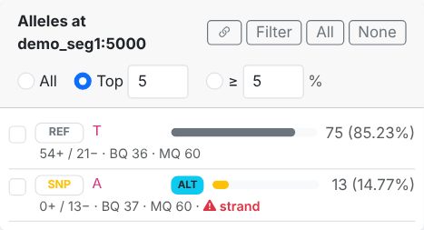

*Figure 25. At `demo_seg1:5000` the ALT allele A is seen on 0 forward and 13 reverse reads, while the reference T is on 54 forward and 21 reverse reads. The ALT allele is marked ⚠ strand.*

- **`15+ / 11−`**: reads on the forward and reverse strand.
- **`BQ 36`**: mean base quality of the allele's base at the site. It is left out for deletions, which have no base there.
- **`MQ 60`**: mean mapping quality of the reads.
- **⚠ strand**: the allele is mostly on one strand while the other reads at the site are not. Allelescope marks it when Fisher's exact test comparing the allele's strand split with that of the other reads gives p < 0.01 and at most 15 % of the allele's reads are on one strand. This is a common sign of an artefact. Point at the mark for the p-value.

### 9.3 Insertions and deletions

A VCF gives the base *before* an insertion or deletion as its position. At that base every read still shows the reference, so it says nothing about the indel. For indel records Allelescope therefore compares the reads one base further on: the first deleted base, or the base that follows the insertion point. The panel says which position it used (Figure 8), and the view stays centred on the VCF position.

### 9.4 Filter by allele

The quickest way: **click an allele** in the panel (anywhere except its tick box), or press its number on the keyboard. The track then shows only read pairs carrying that allele. Click it again, or press **0**, to show all reads.

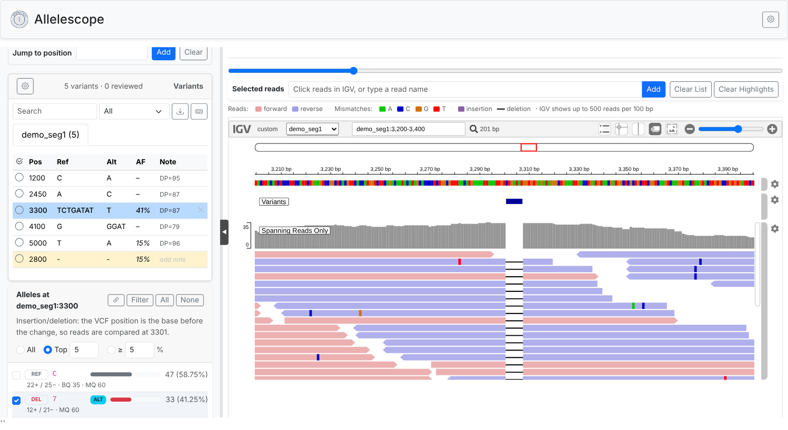

*Figure 26. The deletion at 3300 after clicking `DEL 7`: every read crossing the site carries the deletion.*

To keep several alleles at once:

1. Tick the alleles you want to see. **All** and **None** tick or untick every listed allele.
2. Click **Filter**.

Mates are kept with their reads. The allele filter works together with the other filters and is listed with them, for example `require allele DEL 7`.

It belongs to the site where you set it, because an allele name such as `DEL 7` only means something there. When you select another site the allele filter is cleared, and a short message tells you so.

To clear it yourself, do any one of these:

- click the allele again, or press **0**;
- click the **×** on its badge in the list of filters in use;
- use **Reset filters** or **Clear All**;
- click **Filter** with no allele ticked.

### 9.5 Add a position that is not in the VCF

1. Select the tab for the right reference sequence.
2. Type one or more 1-based positions in **Jump to position**, separated by spaces, commas or semicolons.
3. Click **Add** or press Enter.

Each position is added to the table as a yellow row, the view moves to it, and the allele panel shows what the reads carry there:

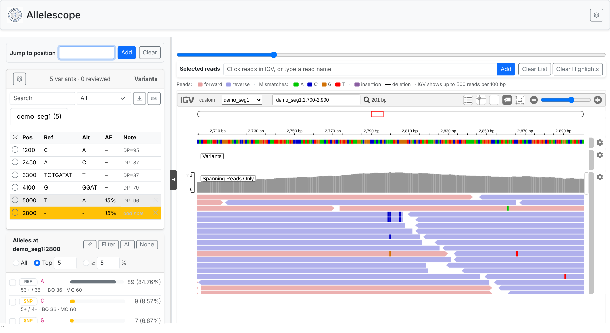

*Figure 27. Position 2800 added by hand. The allele panel shows that most read pairs carry the reference base, with two low-frequency alternatives.*

The allele filter works the same way at these positions:

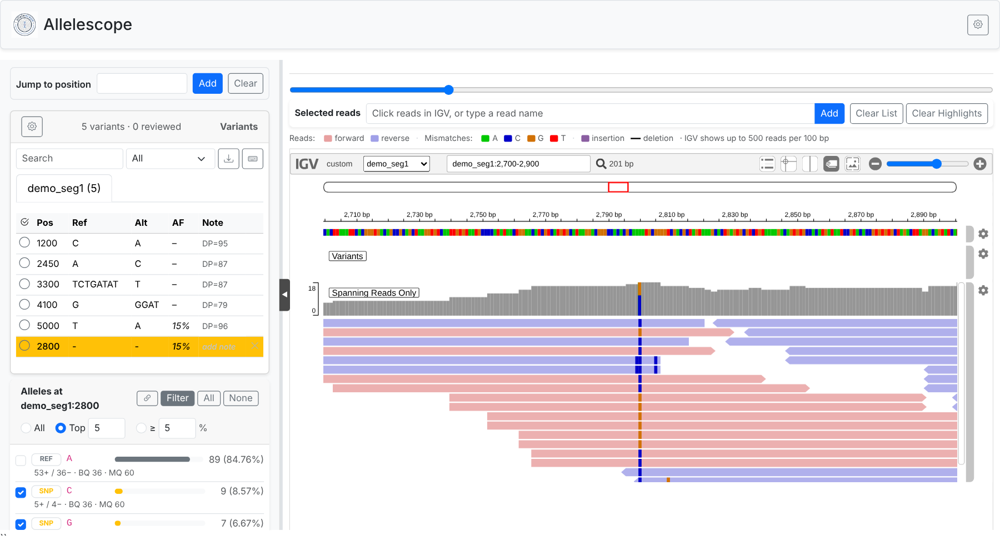

*Figure 28. Only the read pairs carrying the two alternative bases at 2800, chosen with the tick boxes and Filter.*

**Clear** removes all manual rows from the current tab.

Things to know:

- A position that is already in the list is refused with a message. If you typed several positions, the ones after the refused one are not added; enter them again.
- Your browser remembers manual rows, and they appear in every instance on the same server ([section 13.2](#132-what-your-browser-remembers)).
- Nothing is written back to the VCF.

---

## 10. Very deep sites

At very high depth, for example a viral sample at 100,000x or more, showing every read is slow to prepare and impossible to read. Before Allelescope prepares a site for the first time, it counts the read pairs that cross it. If there are more than 2,000, it asks what to show:

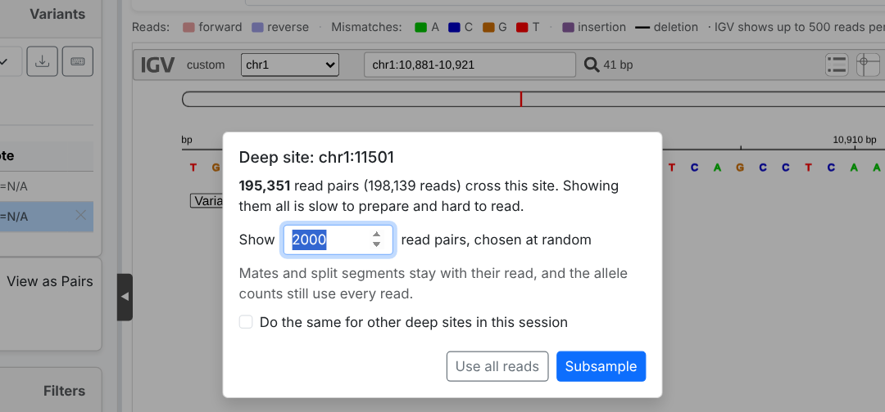

*Figure 29. A site crossed by 195,351 read pairs.*

- **Subsample** shows the number of read pairs in the box. 2,000 is suggested; type another number if you like. The pairs are chosen at random, but the choice is fixed: a read always comes with its mate and split segments, and the same reads are shown every time the site is opened.
- **Use all reads** shows every read pair. At this depth that takes noticeably longer to prepare and to draw.

Tick **Do the same for other deep sites in this session** to stop being asked until the page is reloaded.

**The allele counts always use every read**, whichever you choose. The allele panel says when a site is subsampled:

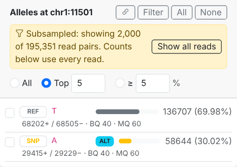

*Figure 30. The site subsampled to 2,000 read pairs. The counts below the notice, including the strand split, come from all 195,351 pairs.*

- **Show all reads** switches the site to the full read set. A deep site shown in full has a **Subsample to 2,000** button instead.
- Your browser remembers the choice for each site of each instance, and the address records it ([section 7.6](#76-sharing-a-view)).
- Filters, **Show only these** / **Hide these** and **Export** work on the reads being shown.
- The subsampled and full versions of a site are kept separately on the server, so switching back to one you have already opened is quick.

As a guide, on the test sample in [Appendix B](#appendix-b-the-datasets-used-in-the-figures) (198,000 reads at the site) preparing a 2,000-pair subsample took about 4 seconds and preparing all reads about 16 seconds.

---

## 11. Filtering reads

### 11.1 How filters combine

Every filter must be satisfied for a read to be shown:

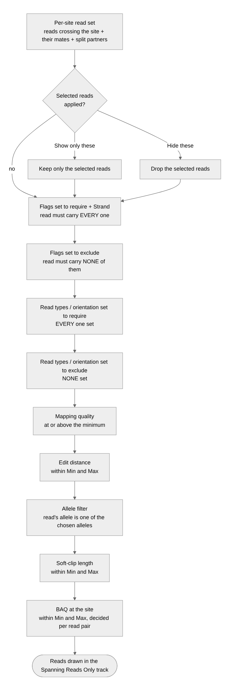

*Figure 31. How the read set for a site is narrowed down.*

A change takes effect immediately: the track reloads with the new read set. Filters stay on as you move between sites. Two things are tied to one site and are reset when you select another: the allele filter ([section 9.4](#94-filter-by-allele)) and **Show only these** / **Hide these** for selected reads ([section 12.2](#122-use-the-selection)).

Filters return to their defaults when the page is reloaded, so save combinations you use often as presets ([section 11.7](#117-reset-download-and-presets)), or keep the address of the view ([section 7.6](#76-sharing-a-view)).

### 11.2 The three sections

Open a section by clicking its title. Only one is open at a time.

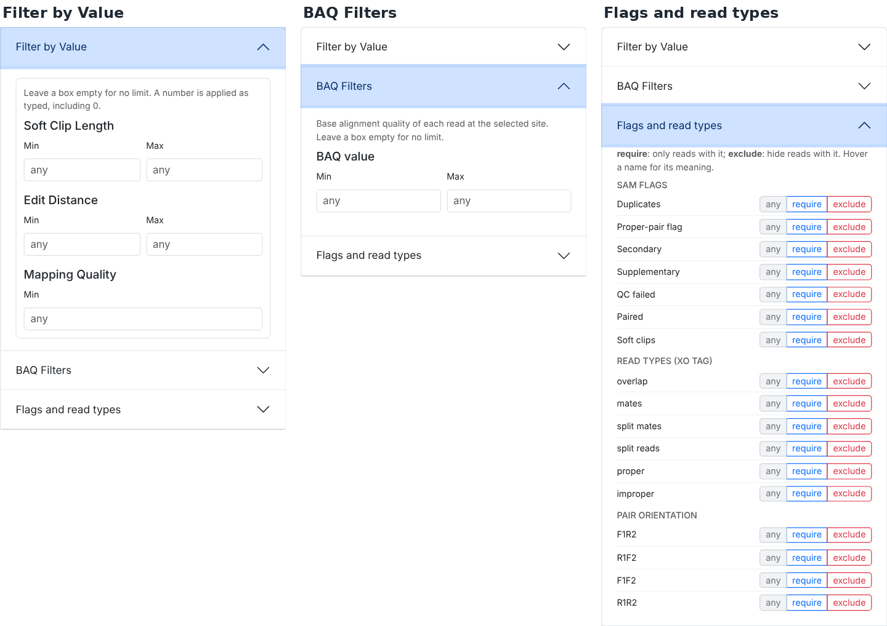

*Figure 32. The three sections of the Filters card, each shown open.*

### 11.3 Strand

The **Strand** selector in the view options limits the reads to one strand. **Plus (+)** shows forward-strand reads and **Minus (-)** shows reverse-strand reads.

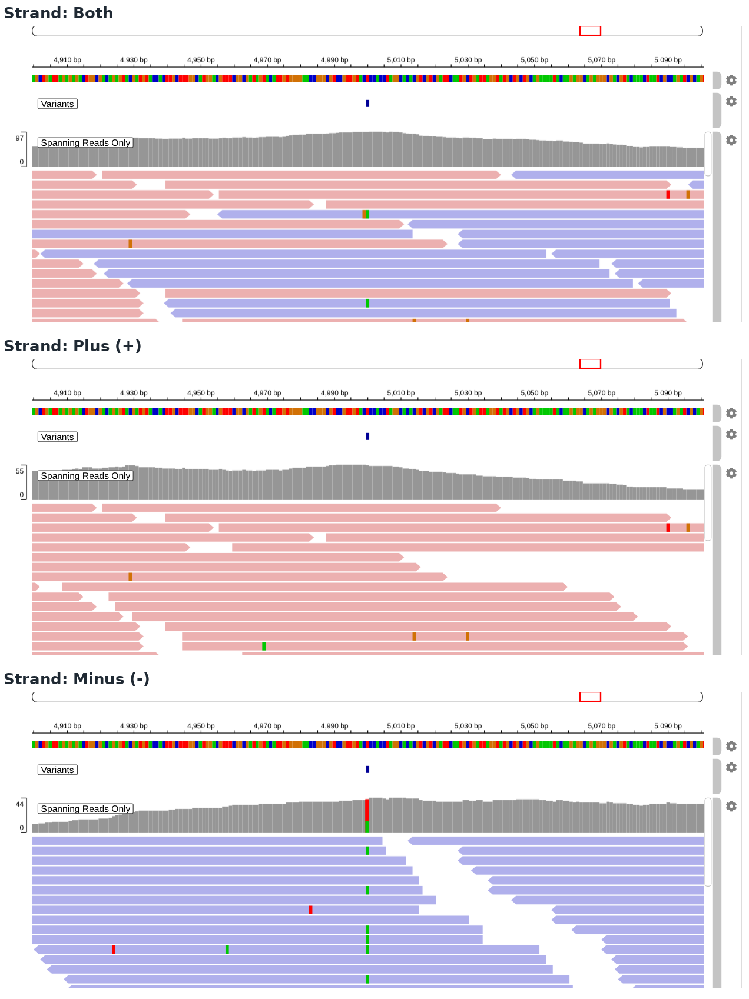

*Figure 33. The same site with each Strand setting. The alternative base (green A in the reads) is carried only by reverse-strand reads, which is a typical sign of an artefact. With only those reads shown it is frequent enough for the coverage bar to colour the site. The allele panel shows the same thing as numbers (Figure 25).*

### 11.4 Numeric limits

**Filter by Value** and **BAQ Filters** hold numeric limits. Every box is empty to start with, and an empty box means no limit, so nothing is filtered until you type a number. A number is applied as typed, including 0: a maximum edit distance of 0 keeps only reads that match the reference exactly.

| Box | Keeps reads with |
|---|---|
| **Soft Clip Length** Min / Max | at least / at most this many soft-clipped bases (both ends added together) |
| **Edit Distance** Min / Max | an edit distance (`NM`) of at least / at most this value |
| **Mapping Quality** Min | a mapping quality of at least this value |
| **BAQ value** Min / Max | a base alignment quality at the selected site of at least / at most this value |

About BAQ:

- Base alignment quality is the base quality lowered where the alignment around the base is uncertain. Allelescope reads it from the `BQ` tag that samtools adds when a site is prepared.
- The limit looks at the reads that cover the site. A read pair is kept or removed as a whole, so a mate that does not reach the site follows the read that does.
- For a read with a deletion at the site, the median over its neighbouring bases is used.

### 11.5 Flags and read types

Each property in **Flags and read types** has three settings:

- **any**: no filter (the default);
- **require**: only reads with the property are shown;
- **exclude**: reads with the property are hidden.

Point at a property's name to see what it means.

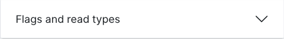

*Figure 34. Duplicates and mates set to exclude; everything else is left at any.*

**SAM flags** come from the BAM:

| Property | Reads it refers to |
|---|---|
| Duplicates | Flagged as duplicates by the build step |
| Proper-pair flag | Flagged as properly paired by the aligner |
| Secondary | Secondary alignments |
| Supplementary | Supplementary alignments (parts of split reads) |
| QC failed | Failed the sequencer's quality check |
| Paired | Came from paired-end sequencing |
| Soft clips | Reads with at least one soft-clipped base. This is separate from the Soft Clip Length boxes |

**Read types (XO tag)** are Allelescope's own classification of each read relative to the site (see Figure 3):

| Property | Reads it refers to |
|---|---|
| overlap | Reads that cross the site, from pairs in which **both** mates cross it |
| mates | Mates that were fetched because their partner crosses the site, and that do not cross it themselves |
| split mates | The other part of a split read, fetched from wherever it maps |
| split reads | Any read that is part of a split alignment (has an `SA` tag) |
| proper | Flagged as properly paired **and** the mates face each other, whichever of read 1 and read 2 is on the forward strand (F1R2 or R1F2) |
| improper | Every other paired read |

**Pair orientation** selects by the orientation of the pair: `F1R2`, `R1F2`, `F1F2`, `R1R2`. F and R are forward and reverse; 1 and 2 are read 1 and read 2.

### 11.6 The filters in use

The filters that are switched on are listed at the top of the Filters card, and the card's header shows how many there are. Click the **×** on a badge to switch that one off, or **Clear All** to reset everything.

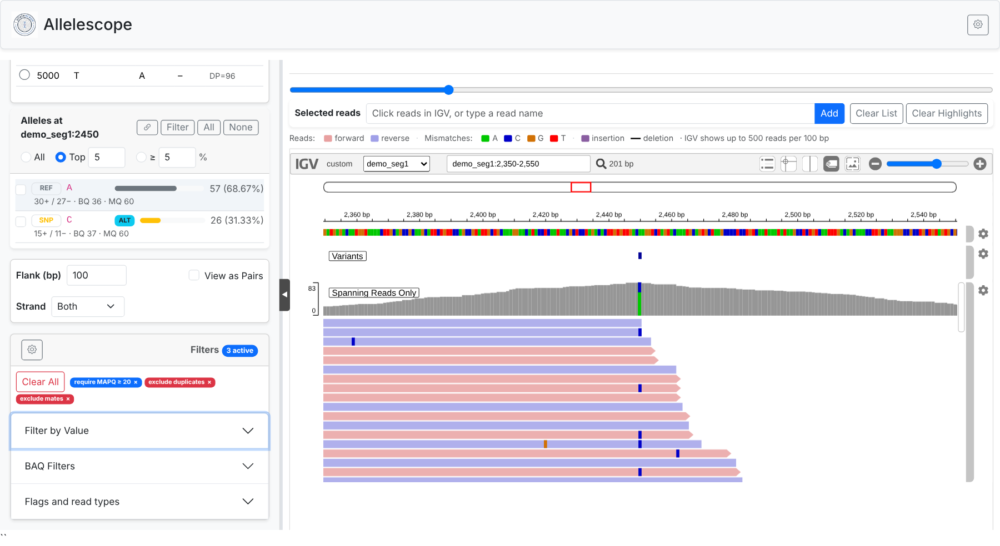

*Figure 35. Duplicates and mates excluded and a minimum mapping quality of 20, leaving non-duplicate reads that cross the site.*

Each badge states the condition that is applied:

- **`require …`** (blue): only reads with this property are shown. These come from properties set to require, from minimums (`require MAPQ ≥ 20`), from the Strand selector and from the allele filter.
- **`exclude …`** (red): reads with this property are hidden. These come from properties set to exclude (`exclude duplicates`) and from maximums (`exclude soft clip > 5`).
- **`view as pairs`** is shown too, although it changes only how reads are drawn.

### 11.7 Reset, download and presets

Open the gear on the Filters card:

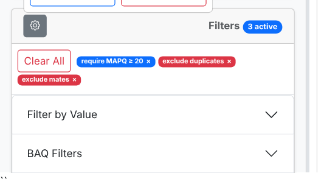

*Figure 36. The Filters gear menu.*

- **Reset filters** returns every filter to its default and clears the allele filter.
- **Download settings (.json)** saves the current filter settings as a file.
- To **save** the current settings as a preset, type a name and click **Save Current**.
- To **load** a preset, choose it in the list and click **Load**. **Delete** removes it; a message offers **Undo**.

Presets are stored by your web browser on your computer. They are not shared with other people or other browsers. Presets saved with an earlier version are converted when you load them. The allele filter is not part of a preset.

---

## 12. Selecting, isolating and exporting reads

### 12.1 Select reads

Hold **Shift** and click a read in the alignment view. The read gets a green outline and its name is added to the **Selected reads** bar above the alignment view. You can also paste a read name into the box there and click **Add** or press Enter.

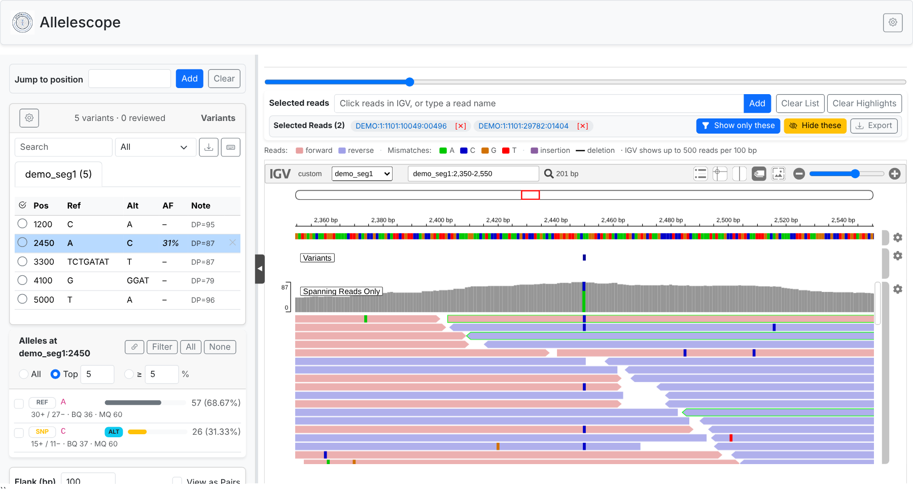

*Figure 37. Two reads selected. Their names are listed in the bar above the alignment view, with the actions for them.*

**[✕]** next to a name removes that read from the selection. **Clear List** empties the selection and restores the full read set; a message offers **Undo**.

### 12.2 Use the selection

| Button | Result |
|---|---|
| **Show only these** | Shows only the selected reads and their mates. |
| **Hide these** | Hides the selected reads and their mates. |
| **Export** | Downloads the selected reads as a BAM file. |

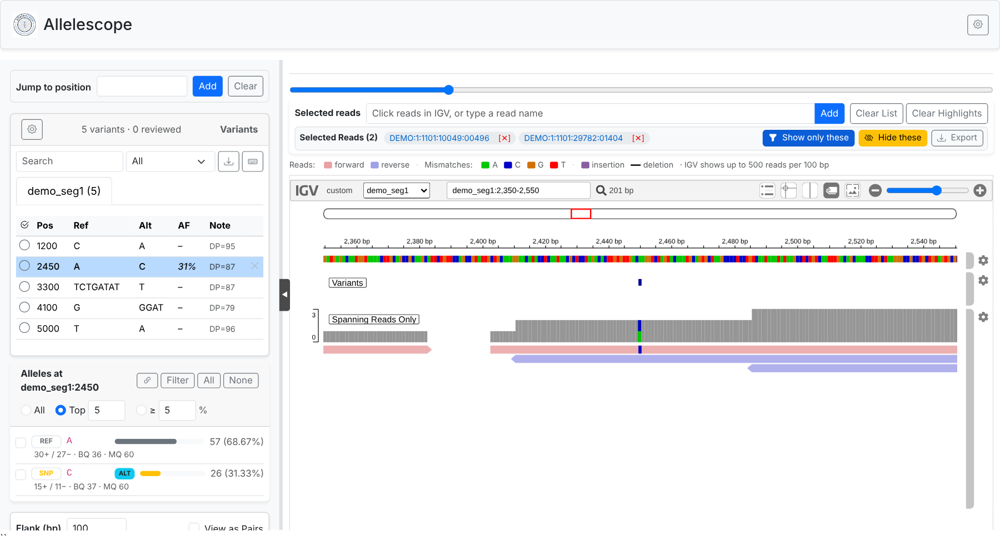

*Figure 38. After Show only these: only the selected read pairs remain.*

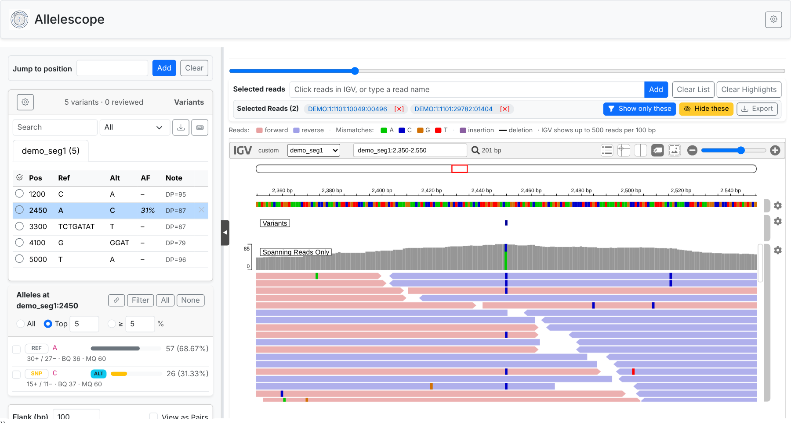

*Figure 39. After Hide these: the selected read pairs are gone and everything else is shown.*

Selection works by read name, so a read and its mate always go together. **Show only these** and **Hide these** act on the selection as it stands when you click. If you change the selection afterwards, click the button again.

Both apply to the site you are viewing. When you select another site the full read set is shown again and a short message says so. Your selection is kept, so you can use it again there.

**Export** saves a file named `selected_reads_<sequence>_<position>.bam` for the site you are viewing. It opens in a new browser tab, so allow pop-ups for the page if nothing downloads. The file holds the selected reads that also pass the filters in force, so reset the filters first if you want every selected read. The file has no index; run `samtools index` on it before loading it elsewhere.

The **Clear Highlights** button does nothing in this version. Use **Clear List**.

---

## 13. Housekeeping: caches, saved lists and presets

### 13.1 The header gear

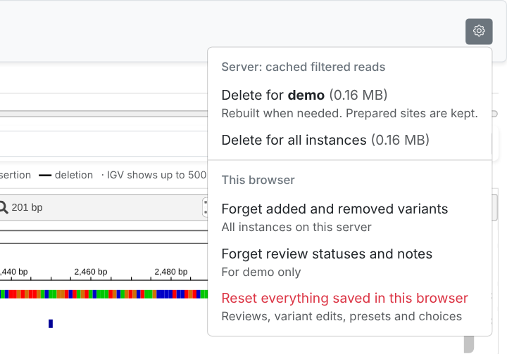

*Figure 40. The header gear menu. Each item says what it affects.*

| Item | What it does |
|---|---|
| **Server: cached filtered reads → Delete for *instance*** | Deletes the filtered read sets kept for this instance (their size is shown). They are rebuilt when needed; prepared sites are kept. |
| **Delete for all instances** | The same for every instance on this server, after asking. This affects other people using the server. |
| **This browser → Forget added and removed variants** | Forgets your edits to the variant list in every instance on this server. A message offers **Undo**. |
| **Forget review statuses and notes** | Forgets the review of this instance only. A message offers **Undo**. |
| **Reset everything saved in this browser** | After asking, forgets everything Allelescope has saved in your browser (reviews of every instance, list edits, presets and choices) and reloads the page. This cannot be undone. |

Questions are asked in a box on the page; press Enter to confirm or Esc to cancel. Clearing a cache is always safe.

### 13.2 What your browser remembers

Some things are saved in your own web browser and reappear the next time you open the page from the same browser:

- review statuses and notes, for each instance;
- your edits to the variant list: positions you added and rows you removed;
- variant-list presets and filter presets;
- the subsampling choice for each deep site;
- the Sequence list layout, and whether the left pane is hidden.

The filter settings themselves are not restored when the page reloads; the address of a view keeps them ([section 7.6](#76-sharing-a-view)).

Your browser stores the list edits, not the list. Each instance applies them to its own variants, so with several instances on one server:

- a position you added by hand appears in every instance that has that sequence;
- a row you removed is hidden in every instance that has a variant at the same sequence and position;
- apart from that, each instance shows its own calls.

### 13.3 Variant-list presets

The Variants gear (Figure 7) can keep several named variant lists, for example the sites still to be checked:

- Type a name and click **Save Current** to save the list as it is now, including manual rows and without removed rows.
- Choose a saved list and click **Load** to show that list. Loading replaces your current edits with the difference between the saved list and this instance's own variants; a message offers **Undo**.
- **Delete** removes the saved list; a message offers **Undo**.

Presets are stored in your browser and are offered in every instance on the server.

### 13.4 Where things are stored

| What | Where | How to remove it |
|---|---|---|
| Per-site read sets | `<instance>/bam/` on the server | Delete the folder. The cache items do not touch it. After an upgrade that changes the read tags or allele table, the server empties it once by itself. |
| Filtered read sets and exports | `<data-dir>/cache/<instance>/` on the server | Header gear → **Delete for *instance*** or **Delete for all instances** |
| Reviews, list edits, presets and choices | Your web browser | Header gear → the **This browser** items |

---

## 14. Known issues in this version

Each of these was observed with the version this manual covers.

| Area | What happens | What to do |
|---|---|---|
| Clear Highlights | The button does nothing. | Use **Clear List**. |
| Read names in the selection | Clicking a name does not move the view. | Find the read by its green outline. |
| Several manual positions | Entry stops at the first position that is already listed. | Enter the remaining positions again. |
| SNP labels | Shown as `REF` when the input BAM has no `MD` tags. | Run `samtools calmd` before building. |
| Filters after a reload | Filters start empty when the page is reloaded. | Use presets, or keep the address of the view. |

---

## 15. Worked examples

The examples use the demo dataset ([Appendix B](#appendix-b-the-datasets-used-in-the-figures)), so you can repeat them.

### 15.1 Is the variant on both strands?

1. Click the variant at `demo_seg1:5000`.
2. Look at the allele panel: the ALT allele A reads `0+ / 13−` and is marked **⚠ strand** (Figure 25).
3. To see it in the reads, set **Strand** to **Plus (+)**, then to **Minus (-)**: the green A appears only with **Minus (-)** (Figure 33).
4. Set **Strand** back to **Both** and press **X** to mark the variant as an artefact; press **E** to note why.

### 15.2 Does the support survive without duplicates?

1. Click a variant.
2. Open **Flags and read types** and set **Duplicates** and **mates** to **exclude** (Figure 34).
3. The track now holds only non-duplicate reads that cross the site, and the list of filters in use shows `exclude duplicates` and `exclude mates` (Figure 35). Compare the allele balance in the coverage bar with what you saw before.
4. Click **Clear All**.

### 15.3 Which reads carry a deletion?

1. Click the deletion at `demo_seg1:3300`.
2. In the allele panel, click `DEL 7`, the row marked `ALT` (Figure 26), or press its number.
3. Shift-click any reads you want to keep a record of and click **Export**.
4. Select the next variant. The allele filter is cleared for you.

### 15.4 Where does the rest of a split read map?

1. Add position `3700` on `demo_seg1`.
2. Open **Flags and read types** and set **split reads** to **require**. The reads that remain all stop at the same base:

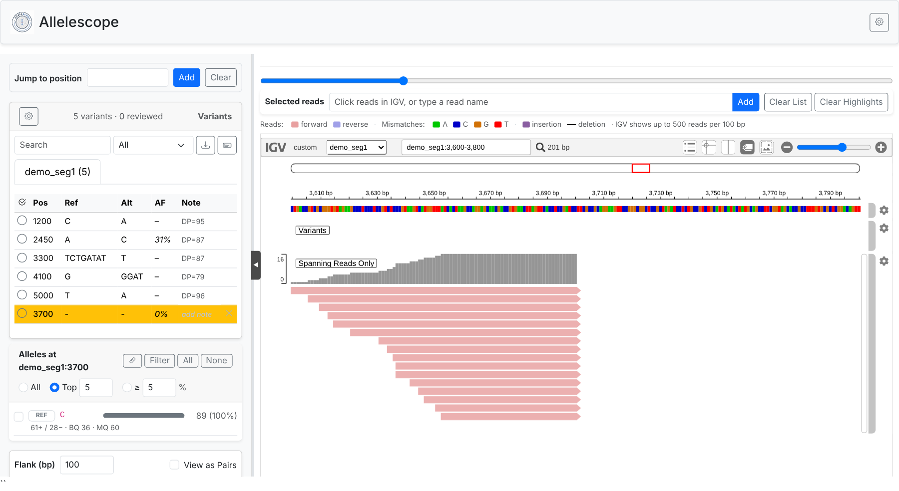

*Figure 41. Only split reads shown. They all end at the breakpoint.*

3. The other parts of these reads are in the same track but on another sequence. Click a read: the details box lists its **Supplementary Alignments**, which give the other location. Type that region into the IGV position box, here `demo_seg2:700-1100`:

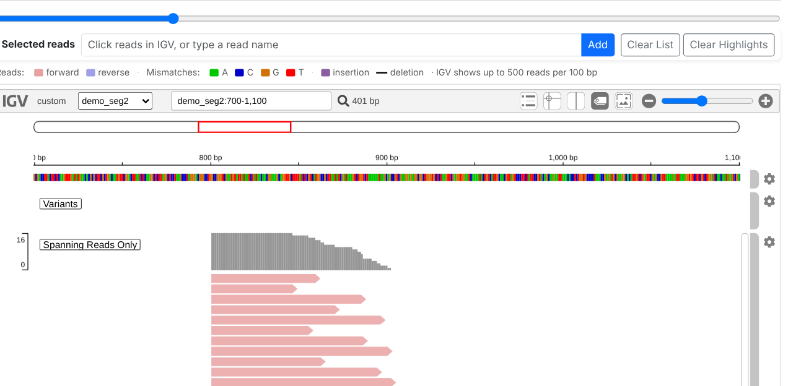

*Figure 42. The partner segments of the same reads on `demo_seg2`.*

4. Set **split reads** back to **any** when you are done.

### 15.5 Are there pairs with an unusual orientation?

1. Add position `5300` on `demo_seg1`.
2. Tick **View as Pairs**.
3. In **Flags and read types**, set **F1F2** under Pair orientation to **require**. Only pairs with both mates on the forward strand remain:

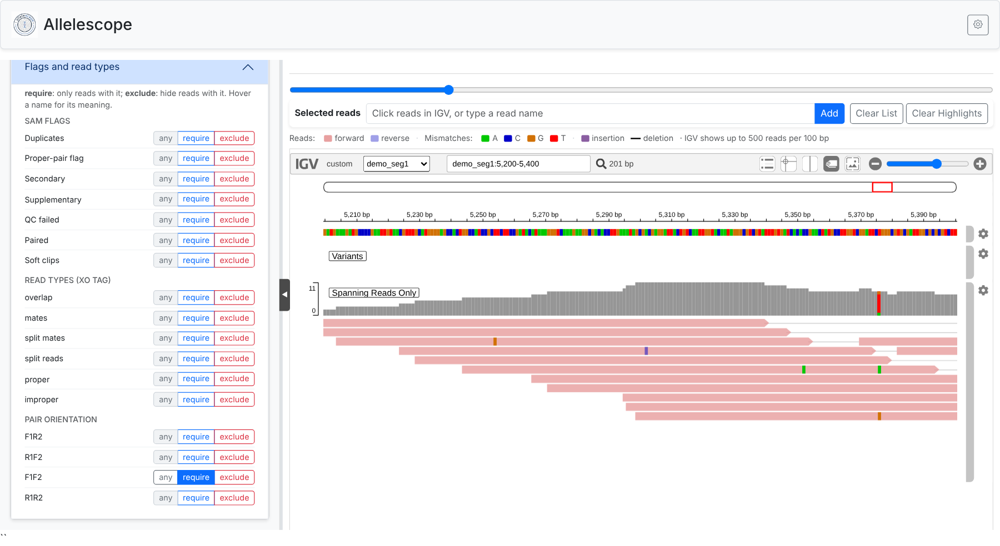

*Figure 43. Pairs in F1F2 orientation.*

### 15.6 Review a whole list

1. Press **N** to open the first variant without a status.
2. Check the allele panel and the reads, and press **C**, **D** or **X**; press **E** to add a note.
3. Press **N** again. Repeat until a message says every variant has a status. With a segmented genome, **N** moves on to the next segment by itself.
4. Download the review as `.tsv` or `.vcf` ([section 7.5](#75-download-the-review)).

---

## 16. Troubleshooting

| Problem | Likely cause and fix |
|---|---|
| The page is unstyled and has no alignment view. | The browser cannot reach `cdn.jsdelivr.net`. Check the internet connection or firewall on the computer showing the page. |
| The read track is empty at a site that should have reads. | A filter is excluding every read. Check the filters in use and click **Clear All**. |
| A variant is missing from the list, or a yellow manual row appears that you did not add here. | Edits to the list are shared between instances (section 13.2). Header gear → **Forget added and removed variants** restores the full list. |
| "Could not read *position*. Is it beyond the end of the sequence?" | The position is beyond the end of the sequence or has no reads, or the wrong sequence tab was selected when you added it. |
| Your statuses and notes are gone. | They are kept per browser and per instance. Another browser, a private window or **Reset everything saved in this browser** starts empty. Download the review to keep it ([section 7.5](#75-download-the-review)). |
| Keyboard shortcuts do nothing. | The cursor is in a box. Click an empty part of the page, or press Esc. |
| A site still shows old reads after the instance was rebuilt. | Delete `<instance>/bam/` and clear the cache. |
| Export does nothing. | The download opens in a new tab. Allow pop-ups for the page. |
| The first click on a site is slow. | Expected. The reads for a site are prepared on the first visit; at very deep sites consider subsampling ([section 10](#10-very-deep-sites)). |
| `build_variant_browser` stops with `'samtools' not found in PATH`. | Install samtools, or activate the environment that has it. |
| `tabix` fails during the build. | The VCF is not sorted. Sort it with `bcftools sort`. |
| The build cannot work out a genome name. | Pass one with `-g`. |
| The page cannot be reached from your computer. | The server is on another machine. Set up the SSH tunnel in section 4.3. |

---

## Appendix A: Reference tables

### A.1 Tags Allelescope adds to reads

These appear in the read details box (Figure 11) and in exported BAM files.

| Tag | Meaning |
|---|---|
| `XO` | Classification of the read relative to the site, as a sum of the values in A.2 |
| `XA` | Allele the read shows at the site: `R` + base (reference), `M` + base (mismatch), `D` + length (deletion), `I` + inserted bases (insertion), `.` (site not covered). Mates carry the value of their partner. |
| `XR` | Pair orientation, for example `F1R2` |
| `XI` | Net length of indels at the site (negative for deletions) |
| `XD` | Longest deletion at the site |
| `XN` | Longest insertion at the site |
| `XS` | Summary of indels at the site, for example `D7` |
| `SL`, `SR` | Soft-clipped bases at the left and right end of the read |
| `NM`, `MD` | Edit distance and mismatch string, recalculated against the reference |
| `BQ` | Base alignment quality offsets added by samtools; the BAQ limits are worked out from it |

### A.2 `XO` values

| Value | Hex | Name in the filter panel | Set when |
|---|---|---|---|
| 1 | 0x1 | overlap | The read crosses the site and both mates of its pair cross it |
| 2 | 0x2 | mates | The read was fetched as the mate of a crossing read |
| 4 | 0x4 | split mates | The read was fetched as the other part of a split read |
| 8 | 0x8 | split reads | The read has an `SA` tag |
| 16 | 0x10 | proper | Paired, flagged as a proper pair, and F1R2 or R1F2 |
| 32 | 0x20 | improper | Paired, and not "proper" as defined above |
| 4096 | 0x1000 | F1R2 | Read 1 forward, read 2 reverse |
| 8192 | 0x2000 | R1F2 | Read 1 reverse, read 2 forward |
| 16384 | 0x4000 | F1F2 | Both forward |
| 32768 | 0x8000 | R1R2 | Both reverse |

Examples: `4112` = 4096 + 16, an F1R2 proper pair. `8208` = 8192 + 16, an R1F2 proper pair. `16416` = 16384 + 32, a pair with both mates forward.

### A.3 The address of a view

| Part | Meaning |
|---|---|
| `v=chrom:pos` | The variant shown |
| `on=…` | Flags and read types that are set, comma-separated: `filter-…` for require, `retain-…` for exclude, for example `retain-duplicates` |
| `min-mapq=20` and similar | Numeric limits and the Strand setting, by the name of the box |
| `xa=MA` | Allele filter, using the `XA` codes in A.1 |
| `s=2000` | Subsample size of a deep site |

### A.4 Columns of the review table (.tsv)

| Column | Meaning |
|---|---|
| `chrom`, `pos`, `ref`, `alt` | The variant |
| `vcf_info` | The VCF `INFO` summary shown in the table |
| `af`, `af_source` | Allele fraction, and `vcf` or `reads` for where it came from |
| `status`, `note` | Your review |
| `observed_alleles` | For sites opened in this session: each allele with its count, share and strand split, for example `SNP:C=26(31.33%,15+/11-)` |

### A.5 Commands

```
build_variant_browser -b BAM -r FASTA [-v VCF] [-g GENOME_NAME] [-o OUT_DIR] [-t THREADS]
start_server [--data-dir DIR] [--port PORT] [--host HOST] [--debug]
docker run --rm -p 127.0.0.1:8000:8000 [-v FOLDER:/data] allelescope [serve | demo | build ARGS]
```

---

## Appendix B: The datasets used in the figures

All figures use small synthetic datasets, not real sequencing data, so nothing in them has biological meaning.

### B.1 The demo dataset

Generated by `demo/simulate_demo_data.py`, which is supplied with this manual and is also in the repository's `demo/` folder together with the finished files. The reference is random sequence and the reads are simulated 150 bp pairs.

| Sequence | Length | Contents |
|---|---|---|
| `demo_seg1` | 6,000 bp | All the variants below |
| `demo_seg2` | 3,000 bp | No variants; receives the other half of the split reads |
| `demo_seg3` | 1,500 bp | No variants |

| Position on `demo_seg1` | In the VCF | What was simulated |
|---|---|---|
| 1200 | yes | SNP in nearly all reads |
| 2450 | yes | SNP in about 30% of read pairs |
| 2800 | no | Two low-frequency alternative bases |
| 3300 | yes | 7-base deletion in about 40% of read pairs |
| 3700 | no | Breakpoint: split reads continuing at `demo_seg2:801` |
| 4100 | yes | 3-base insertion in about 25% of read pairs |
| 5000 | yes | SNP carried only by reverse-strand reads |
| 5150–5800 | no | A few pairs with both mates on the forward strand |

About 8% of read pairs are duplicated, and about 5% of reads have a soft-clipped end.

To recreate it (needs `pysam`, `samtools`, `bgzip` and `tabix`):

```bash
python demo/simulate_demo_data.py demo_input
samtools calmd -b demo_input/demo_reads.bam demo_input/demo_ref.fa > demo_input/demo_reads.md.bam
bgzip demo_input/demo_calls.vcf

build_variant_browser -b demo_input/demo_reads.md.bam -r demo_input/demo_ref.fa \
    -v demo_input/demo_calls.vcf.gz -o Browsers/demo
start_server --data-dir Browsers --port 8000
```

Then open `http://localhost:8000/demo/`.

### B.2 Datasets for section 8 and section 10

| Dataset | Used in | Contents |
|---|---|---|
| 8-segment genome | Figures 18–20, 23, 24 | Eight random sequences of 0.9–2.4 kb named like influenza segments (`seg1_PB2` … `seg8_NS`), about 30x paired reads, one or two SNPs per segment, `AF` in the VCF |
| 41-contig assembly | Figures 21, 22 | Forty contigs `contig_01` … `contig_40` and one with a 63-character assembler-style name, one SNP each |
| Deep viral-like sample | Figures 29, 30 | Two 30 kb sequences, 1.4 million reads, about 198,000 reads crossing one SNP at `chr1:11501` |
